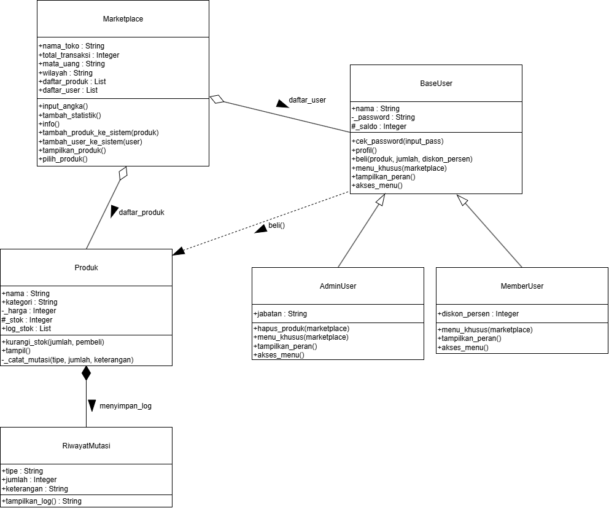
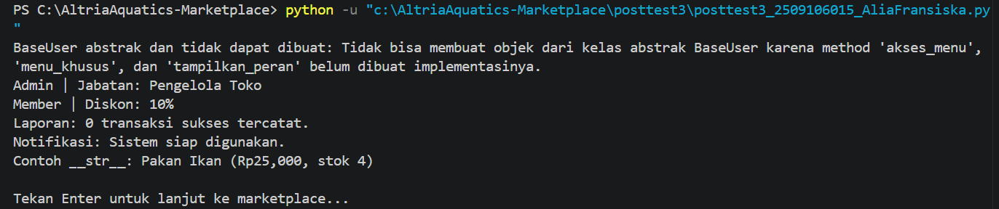
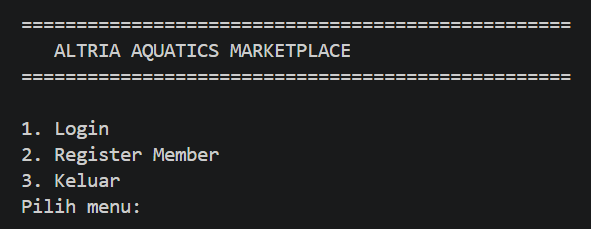
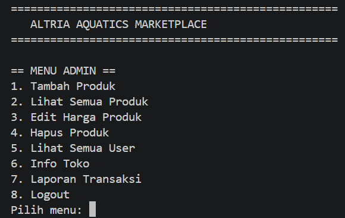
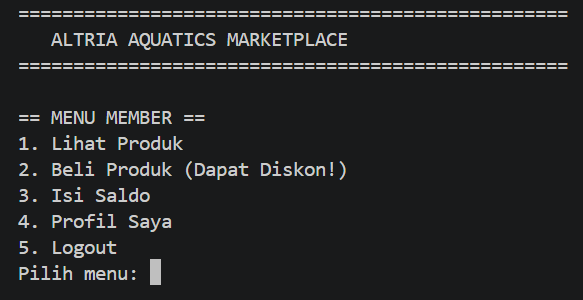
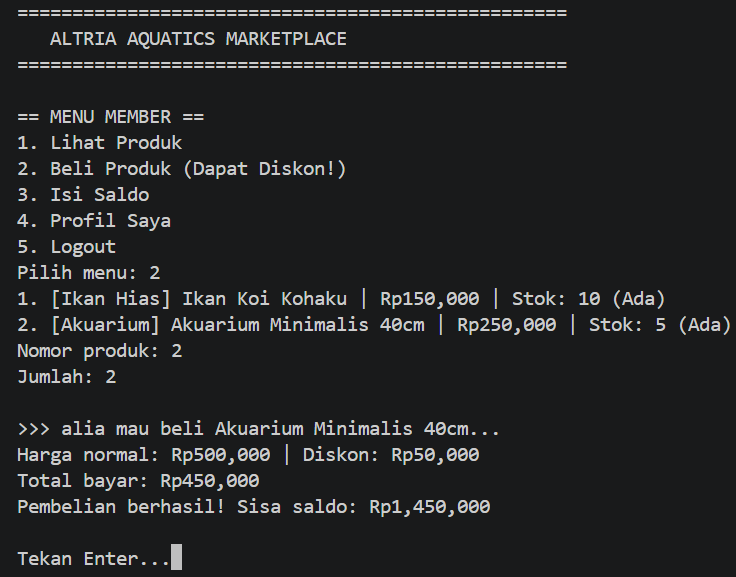
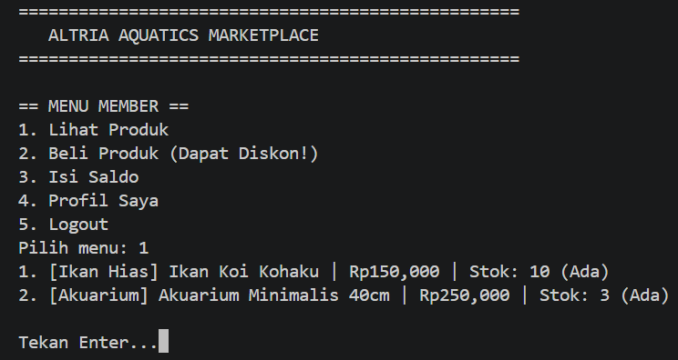

# Altria Aquatics Marketplace

Altria Aquatics Marketplace adalah program simulasi toko ikan hias dan perlengkapan akuatik berbasis CLI (Command-Line Interface) menggunakan Python. Program ini dirancang dengan struktur Object-Oriented Programming (OOP) untuk memenuhi kriteria yang mencakup Pewarisan, Abstraksi, Polimorfisme, Duck Typing, Operator Overloading, serta penerapan prinsip SOLID.

## Fitur

- Login menggunakan username dan password, serta registrasi member.
- Admin dapat menambahkan produk, melihat produk dan user, mengubah harga, menghapus produk, menampilkan informasi toko, dan melihat laporan transaksi.
- Member dapat melihat produk, membeli produk dengan diskon, mengisi saldo, serta melihat profil.
- Pemeriksaan harga, stok, jumlah pembelian, saldo, dan rentang diskon.
- Riwayat mutasi stok masuk dan keluar pada setiap produk.
- Penghitung transaksi sukses pada kelas `Marketplace`.
- Demonstrasi `BaseUser` sebagai abstract base class, duck typing, dan representasi objek melalui `__str__`.

## Akun yang ada di program:
Untuk memudahkan pengujian jalannya program, terdapat dua akun default yang sudah ada di dalam program :
| Role | Username | Password |
|---|---|---|
| Admin | `admin` | `admin123` |
| Member | `alia` | `015` |

## Class Diagram

### Penjelasan Relasi Antar Kelas
Berdasarkan diagram UML di atas, berikut adalah jenis relasi antar kelas pada program:
1. Komposisi (Produk ♦-- RiwayatMutasi)
Dipilih sebagai komposisi karena objek RiwayatMutasi (log mutasi stok masuk dan keluar) dibuat dan siklus hidupnya dikendalikan sepenuhnya di dalam kelas Produk melalui method _catat_mutasi(). Jika objek produk dihapus, maka riwayat mutasinya otomatis akan hilang dan tidak dapat berdiri sendiri.

2. Agregasi (Marketplace ♢-- Produk & BaseUser)
Dipilih sebagai agregasi karena kelas Marketplace hanya bertindak sebagai wadah atau penampung koleksi (daftar_produk dan daftar_user). Objek dari kelas Produk dan BaseUser diinisialisasi secara terpisah di luar kelas, sehingga objek-objek tersebut tetap dapat berdiri sendiri meskipun instance Marketplace dihapus.

3. Asosiasi (BaseUser --> Produk)
Merupakan asosiasi fungsional karena objek dari kelas BaseUser berinteraksi sementara dengan kelas Produk. Interaksi ini terjadi saat proses transaksi (beli()) dijalankan, di mana BaseUser memanggil method kurangi_stok() yang dimiliki oleh produk terkait.

4. Pewarisan / Inheritance (AdminUser & MemberUser ◁-- BaseUser)
Merupakan relasi pewarisan (inheritance) di mana subclass AdminUser dan MemberUser mewarisi seluruh atribut serta method dari parent class abstrak BaseUser.

---

## Penerapan OOP

### Abstraksi melalui `BaseUser`

Penerapan abstraksi dilakukan melalui kelas BaseUser yang dijadikan sebagai Abstract Base Class (ABC).

Abstract Method: Terdapat 3 abstract method (`menu_khusus`, `tampilkan_peran`, dan `akses_menu`) yang memaksa setiap subclass untuk mendefinisikan perilakunya sendiri.

Method Konkret: Terdapat method biasa yang langsung digunakan bersama oleh semua subclass, seperti `cek_password()`, `profil()`, dan `beli()`.

Bukti Tidak Bisa Diinstansiasi: Pada awal fungsi `demo_oop()`, terdapat upaya membuat objek `BaseUser` secara langsung. Program menolak hal tersebut dan menghasilkan `TypeError`, yang kemudian ditangkap oleh blok try-except untuk menampilkan pesan validasi.

### Pewarisan dan polimorfisme

`AdminUser` dan `MemberUser` mewarisi `BaseUser`, memanggil `super().__init__(...)`, serta mengimplementasikan abstract method. Keduanya dapat diperlakukan sebagai `BaseUser`, sementara perilaku spesifiknya berbeda:

- `tampilkan_peran()` menampilkan jabatan admin atau persentase diskon member.
- `akses_menu()` menampilkan menu sesuai peran.
- `menu_khusus()` menjalankan pilihan yang berbeda untuk admin dan member.

Ini merupakan polimorfisme melalui pewarisan: pemanggilan method yang sama menghasilkan perilaku sesuai kelas objek.

### Duck typing pada `sampaikan_info()`

Duck typing diterapkan melalui fungsi `sampaikan_info(sumber)`. Fungsi ini tidak mensyaratkan tipe kelas tertentu, melainkan hanya membutuhkan objek yang memiliki method `cetak_info()`. Sebagai demonstrasi, objek dari kelas `LaporanKeuangan` dan `NotifikasiSistem` (yang tidak memiliki relasi pewarisan) dimasukkan ke dalam fungsi ini dan keduanya dapat dieksekusi dengan sempurna.

### Operator overloading melalui `__str__`

Konsep ini diterapkan menggunakan magic method `__str__` pada kelas `Produk`. Method ini mengubah cara program merepresentasikan objek menjadi bentuk string. Ketika objek produk dicetak, output yang ditampilkan bukan alamat memori, melainkan teks rapi berisi nama produk, harga, dan sisa stok.

### Enkapsulasi dan variasi method

- `__harga` dibaca/diubah melalui property `harga`; setter menolak nilai negatif.
- `__password` diperiksa melalui `cek_password()`.
- `_stok` dan `_saldo` menunjukkan atribut internal berdasarkan konvensi Python; tersedia property pembaca untuk `stok` dan `saldo`.
- `Marketplace.input_angka()` adalah `@staticmethod`, sedangkan `tambah_statistik()` adalah `@classmethod`. `info()` dan `pilih_produk()` bekerja pada instance marketplace.

## Prinsip SOLID
### Open/Closed Principle (OCP):
Desain kelas BaseUser sangat terbuka untuk perluasan (ekstensi) tetapi tertutup untuk modifikasi. Jika di masa depan diperlukan tipe pengguna baru, pembuatan fitur ini cukup dilakukan dengan membuat kelas baru yang mewarisi BaseUser, tanpa perlu memodifikasi kode inti pada BaseUser itu sendiri.

### Dependency Inversion Principle (DIP) / Dependency Injection:
Penerapan prinsip ini terlihat pada cara kerja fitur Duck Typing di dalam fungsi sampaikan_info(sumber), yang hanya bergantung pada abstraksi (apakah objek tersebut memiliki method cetak_info()). Selain itu, dependensi juga dikelola dengan menyuntikkan objek Marketplace (Dependency Injection) sebagai parameter ke dalam method menu_khusus(marketplace), sehingga meminimalisir ketergantungan yang kaku antar kelas.

## Screenshot Output

### Demonstrasi OOP dan bukti TypeError

### Menu login

### Menu admin

### Menu member

### Pembelian dan mutasi stok

